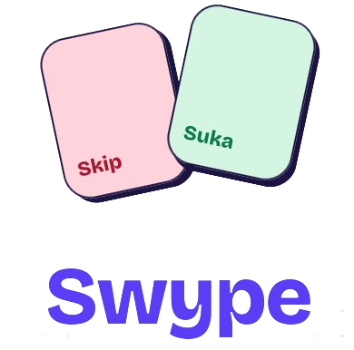
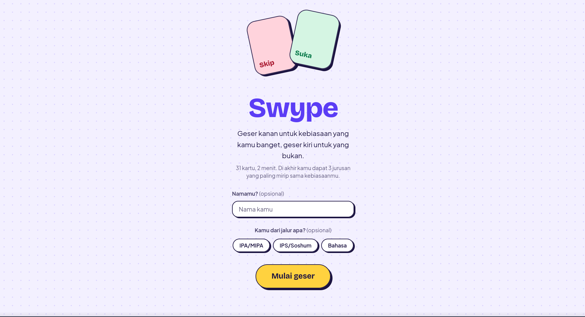
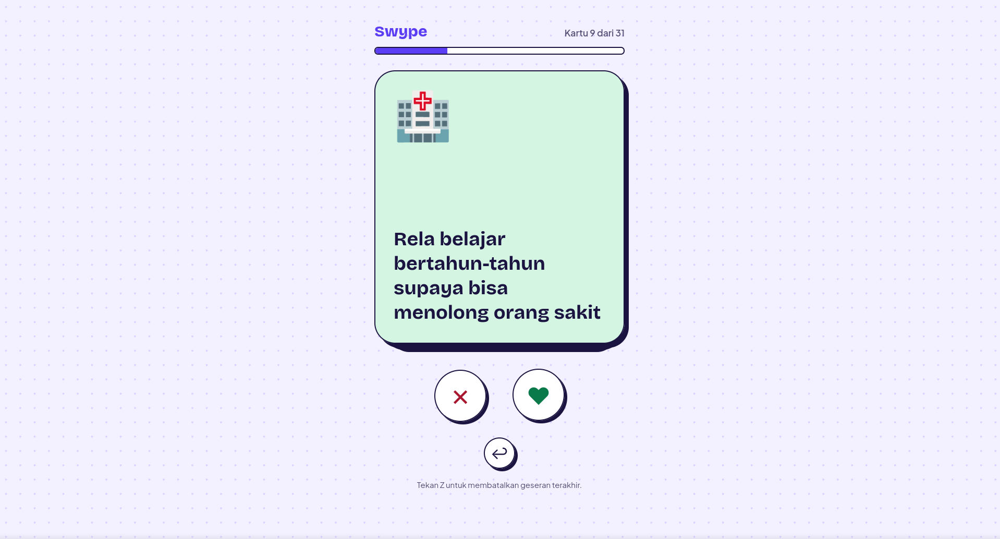
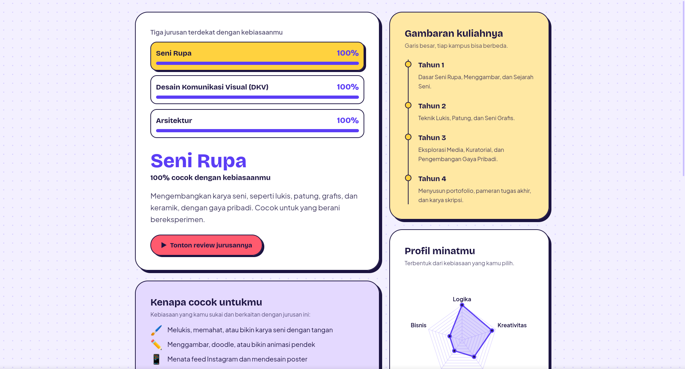

<p align="center"></p>


<br>

# Screnshot
<p align="center"></p>
<p align="center"></p>
<p align="center"></p>

# 🤔  Apa itu Swype?

Swype adalah website untuk ditujukkan seorang SMA yang sulit menentukan jurusan, memilih jalur pendidikan, dan merencanakan karir sesuai minat. Swype hadir sebagai membantu dalam hal tersebut dengan cara memberikan beberapa pertanyaan dan variatif untuk menentukan seorang SMA akan mencari jurusan, pendidikan dan karir.

# ✨ Fitur Unggulan
- Swiper card interaktif
- Probabilitas dari jurusan yang terpilih
- Rekomendasi Karir
- Grafik minat 

# Mau coba?

Website ini dapat diakses melalui https://swype-sigma.vercel.app secara gratis.

atau

clone repository :

```bash
git clone https://github.com/athaabbas/swype.git
```

jalankan ini dengan Live Server dan akses `http://localhost`